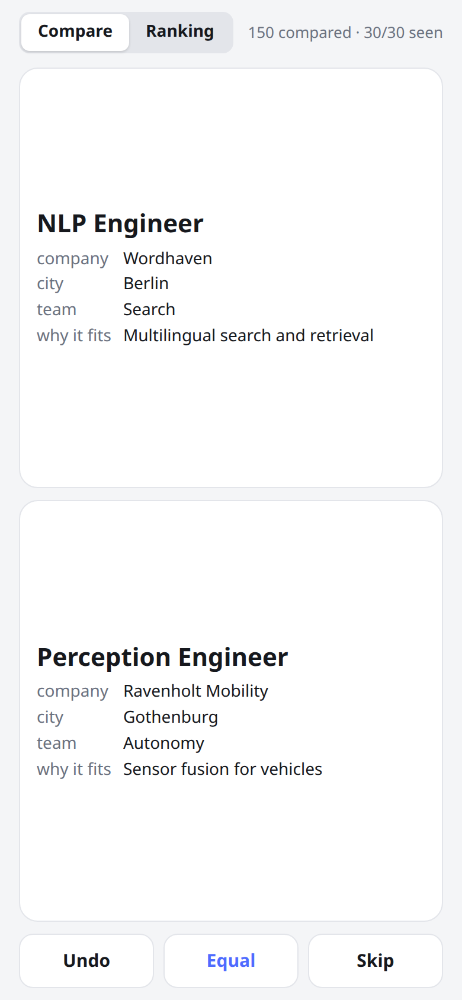
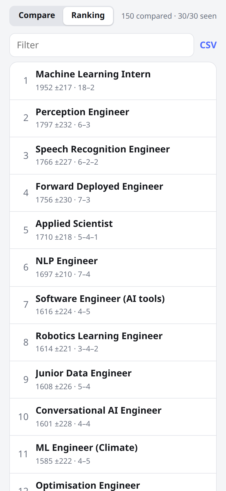

# pairwise-ranking

A small web app that ranks any list (job openings, apartments, recipes) from head-to-head choices. It fits a Bradley-Terry model with the MM algorithm and keeps asking about the pairs it is least sure of.

## Result

I use it to rank the job openings I'm considering. The result is a ranking I trust: it decides where I spend my application time, and every choice makes it sharper.

On the bundled demo (30 made-up roles, 150 simulated choices from known hidden strengths), the fitted order reaches a Spearman correlation of 0.81 with the hidden order. Run `python3 demo/make_demo_db.py` to reproduce it.

<p>
  
  &nbsp;
  
</p>

*Screenshots use the demo data in `demo/`.*

## How it works

- Every choice (A wins, B wins, or equal) is stored as a row in a SQLite file, so the ranking survives restarts and can be undone.
- **Model.** Bradley-Terry gives every entry a strength *s*. The chance that *i* beats *j* is *s<sub>i</sub>* / (*s<sub>i</sub>* + *s<sub>j</sub>*). A tie counts as half a win for each side.
- **Fitting.** The MM algorithm ([Hunter, 2004](https://doi.org/10.1214/aos/1079120141)) updates each strength in closed form until it converges. It is warm-started from the previous fit, so it is fast enough to refit after every tap.
- **Prior.** Each entry gets one virtual win and one virtual loss against an average opponent. Entries that have never lost (or never won) then still get a finite score.
- **Uncertainty.** A standard error for each entry comes from the Fisher information. Scores are shown on an Elo-like scale (1500 is average), with a ±95% band.
- **Choosing the next pair.** First the entry whose score is least certain (highest standard error, picked from a random sample of up to 40). Then the opponent whose result is hardest to predict, weighted by its own uncertainty and penalised for repeat matchups (picked from a random sample of up to 120). Pairs shown in the last few rounds are avoided.
- The front end is a single page of plain HTML/JS, built to be added to a phone's home screen. Results export to CSV.

## Quick start

Needs Python 3.8 or newer. There are no dependencies: everything uses the standard library.

```bash
git clone https://github.com/Magnus-DM/pairwise-ranking.git
cd pairwise-ranking
cp demo/demo.sqlite my-choices.sqlite          # start from the 150 simulated choices
python3 ranker.py demo/roles.csv --db my-choices.sqlite
# open http://127.0.0.1:8000
```

Click a card (or press `1`/`2`) to choose, `e` for equal, `s` to skip and `z` to undo. The **Ranking** tab shows the current order. **CSV** downloads it.

Run the tests (optional):

```bash
python3 -m venv .venv && .venv/bin/pip install -r requirements-dev.txt
.venv/bin/pytest
```

## Data

Bring your own list as CSV/TSV, JSON or JSONL, one entry per row:

```bash
python3 ranker.py my_list.csv --title name --show "city,price,notes" --image photo
```

- `--id` is the column with unique ids. The default is a column called `id`, otherwise the row number.
- `--title` is the card heading. `--show` lists the extra fields to display. `--image` takes an image URL or a path relative to the data file.
- By default, choices are stored next to the data file as `<data file>.prefs.sqlite`. Use `--db` to change that.

To use it from your phone, keep the default `127.0.0.1` binding and expose the port privately, for example through a VPN such as Tailscale. The app has no login, so don't put it on the open internet.

The demo list in `demo/roles.csv` is made up: the companies and roles are fictional. `demo/make_demo_db.py` rebuilds `demo/demo.sqlite` with a fixed seed.

## Project structure

```
ranker.py               the whole app: data loading, Bradley-Terry/MM fit, pair selection, web server, embedded HTML/JS
demo/roles.csv          30 made-up roles used for the demo
demo/make_demo_db.py    simulates choices from hidden strengths (seeded) and writes demo/demo.sqlite
demo/demo.sqlite        the resulting demo database (150 choices)
tests/test_ranker.py    MM recovers known strengths, persistence and undo, input validation
docs/                   screenshots
```

## Context

Personal project, built on my own in 2026. I run a version of it on top of the job database of my personal agent system. That version adds Notion sync, statuses and an applications view, and it stays private. This repository is the standalone ranking app and works with any list.

## References

- R. A. Bradley and M. E. Terry (1952). Rank analysis of incomplete block designs: I. The method of paired comparisons. *Biometrika*, 39(3/4), 324–345.
- D. R. Hunter (2004). MM algorithms for generalized Bradley-Terry models. *The Annals of Statistics*, 32(1), 384–406. [doi:10.1214/aos/1079120141](https://doi.org/10.1214/aos/1079120141)

## License

[MIT](LICENSE) © 2026 Magnus De Maerteleire
